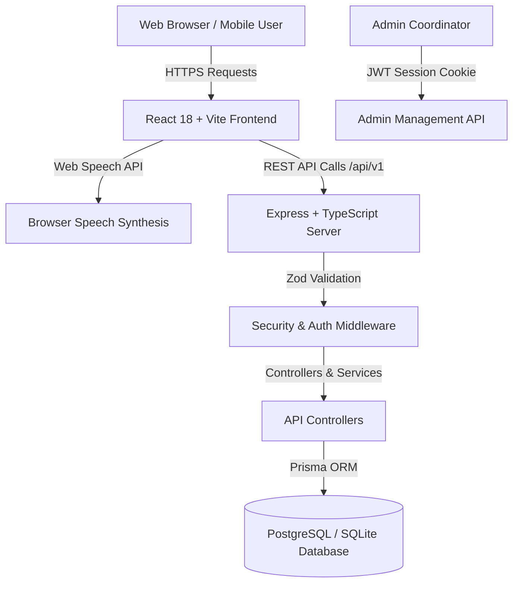
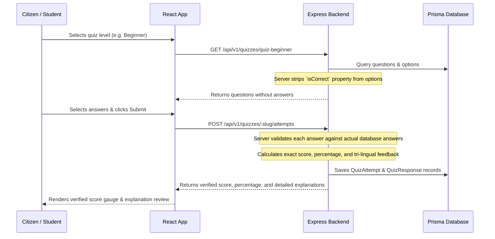

# System Architecture & Technical Design
## Digital Suraksha — Full-Stack Fraud Awareness Platform

---

## 1. High-Level Architecture Overview

Digital Suraksha uses a modern, modular, decoupled architecture organized as an npm workspace monorepo:

---

## 2. Monorepo Structure & Separation of Concerns

1. **`@digital-suraksha/shared` (`packages/shared`)**:
   - Contains single source of truth for TypeScript interfaces (`Language`, `Topic`, `Quiz`, `Scenario`, `Category`).
   - Shared Zod validation schemas (`quizSubmissionSchema`, `feedbackSubmissionSchema`, `adminLoginSchema`).
   - Shared constants (`APP_CONFIG`, `BANK_HELPLINES`, `GOLDEN_RULES`).
   - Eliminates type drift between backend and frontend.

2. **`@digital-suraksha/backend` (`packages/backend`)**:
   - Express 4.x REST API written in strict TypeScript.
   - Centralized error handling and privacy-conscious logging.
   - Prisma ORM data access layer with support for both PostgreSQL (Production/Docker) and SQLite (Local zero-config student runs).
   - Strict server-side quiz scoring calculation preventing client score tampering.

3. **`@digital-suraksha/frontend` (`packages/frontend`)**:
   - React 18 single page application powered by Vite.
   - Tailwind CSS design system with custom brand tokens (Navy `#0f172a`, Emerald `#059669`).
   - Multilingual context provider managing real translations in हिन्दी, मराठी, and English.
   - Web Speech Synthesis context provider with language detection and fallback.

---

## 3. Data Flow & Security Pipelines

### A. Tamper-Proof Quiz Submission Pipeline

### B. Multilingual Voice Guidance Architecture
The browser's native `SpeechSynthesis` API is utilized without requiring paid external cloud text-to-speech services:
1. `VoiceContext` initializes `window.speechSynthesis` and listens for `onvoiceschanged`.
2. When the citizen clicks the voice button, the text is sanitized (stripping markdown syntax and special characters).
3. The engine inspects `LanguageContext.language`:
   - If `hi`: matches `hi-IN` Indian Hindi voices.
   - If `mr`: matches `mr-IN` Marathi voices (fallback to `hi-IN`).
   - If `en`: matches `en-IN` or `en-US` English voices.
4. Voice playback speed is set to `0.9x` to ensure comfortable comprehension for elderly citizens.
5. If speech synthesis is unsupported on an older browser, the button gracefully falls back without throwing runtime errors.
