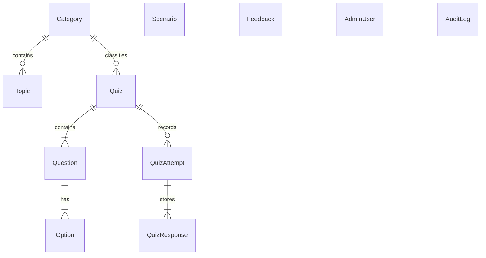

# Database Architecture & Schema Documentation
## Digital Suraksha — Prisma ORM & Database Design

---

## 1. Database Philosophy & Design
The Digital Suraksha database is designed to meet two critical requirements:
1. **Production & CI Ready**: Full support for **PostgreSQL** in containerized environments (Docker Compose / Cloud Hosting / GitHub Actions).
2. **Zero-Config Local Demonstration**: 100% compatible with local **SQLite** (`dev.db`) out-of-the-box, ensuring college professors, evaluators, and students can run `npm run dev` immediately on any machine without needing a running PostgreSQL daemon.

---

## 2. Entity Relationship Diagram (ERD)



---

## 3. Core Models & Field Definitions

### `Category`
Organizes cyber fraud topics and quizzes into intuitive domains.
- `id`: UUID (Primary Key)
- `slug`: Unique string identifier (e.g. `upi-payments`, `banking-fraud`)
- `nameEn`, `nameHi`, `nameMr`: Localized titles
- `descriptionEn`, `descriptionHi`, `descriptionMr`: Localized summaries
- `icon`: Lucide icon reference name
- `order`: Integer sort order

### `Topic`
Contains comprehensive educational guides for each specific fraud vector.
- `id`: UUID (Primary Key)
- `slug`: Unique string identifier (e.g. `fake-bank-calls`, `screen-sharing-fraud`)
- `categoryId`: Foreign key referencing `Category.id` (onDelete: Cascade)
- `severity`: `'medium'` | `'high'` | `'critical'`
- `tags`: JSON string array of searchable tags
- `titleEn`, `titleHi`, `titleMr`: Tri-lingual titles
- `definitionEn`, `definitionHi`, `definitionMr`: Definitions
- `howItWorksEn`, `howItWorksHi`, `howItWorksMr`: Fraud mechanics
- `fictionalExampleEn`, `fictionalExampleHi`, `fictionalExampleMr`: Relatable scenarios
- `warningSignsEn`, `warningSignsHi`, `warningSignsMr`: JSON arrays of red flags
- `safeActionsEn`, `safeActionsHi`, `safeActionsMr`: JSON arrays of prevention steps
- `victimGuidanceEn`, `victimGuidanceHi`, `victimGuidanceMr`: JSON arrays of emergency recovery steps

### `Quiz`, `Question`, and `Option`
Manages quizzes across difficulty levels (`beginner`, `intermediate`, `advanced`).
- `Question.difficulty`: `'beginner'` | `'intermediate'` | `'advanced'`
- `Question.points`: Integer score points (default 10)
- `Option.isCorrect`: Boolean indicator (hidden on public API, evaluated on server)

### `QuizAttempt` and `QuizResponse`
Tracks anonymous or citizen learning attempts and validated scores.
- `QuizAttempt.percentage`: Float percentage (0 - 100)
- `QuizAttempt.passed`: Boolean (true if score >= 60%)

### `Scenario`
Interactive assessment cards comparing safe vs dangerous actions.
- `isSafe`: Boolean (true = safe practice, false = scam trap)
- `explanationEn`, `explanationHi`, `explanationMr`: Explanations
- `recommendationEn`, `recommendationHi`, `recommendationMr`: Recommendations

### `AdminUser` & `AuditLog`
Manages administration credentials and immutable action logs.
- `AdminUser.passwordHash`: Secure bcrypt hashed string
- `AuditLog.action`: Action identifier (e.g. `ADMIN_LOGIN`, `CREATE_TOPIC`)

---

## 4. Database Setup & Migration Commands

```powershell
# Generate Prisma Client
npm run prisma:generate --workspace=packages/backend

# Push schema directly to database (creates dev.db locally)
npm run prisma:push --workspace=packages/backend

# Seed database with authentic tri-lingual curriculum
npm run prisma:seed --workspace=packages/backend

# Full one-command setup
npm run db:setup --workspace=packages/backend
```
